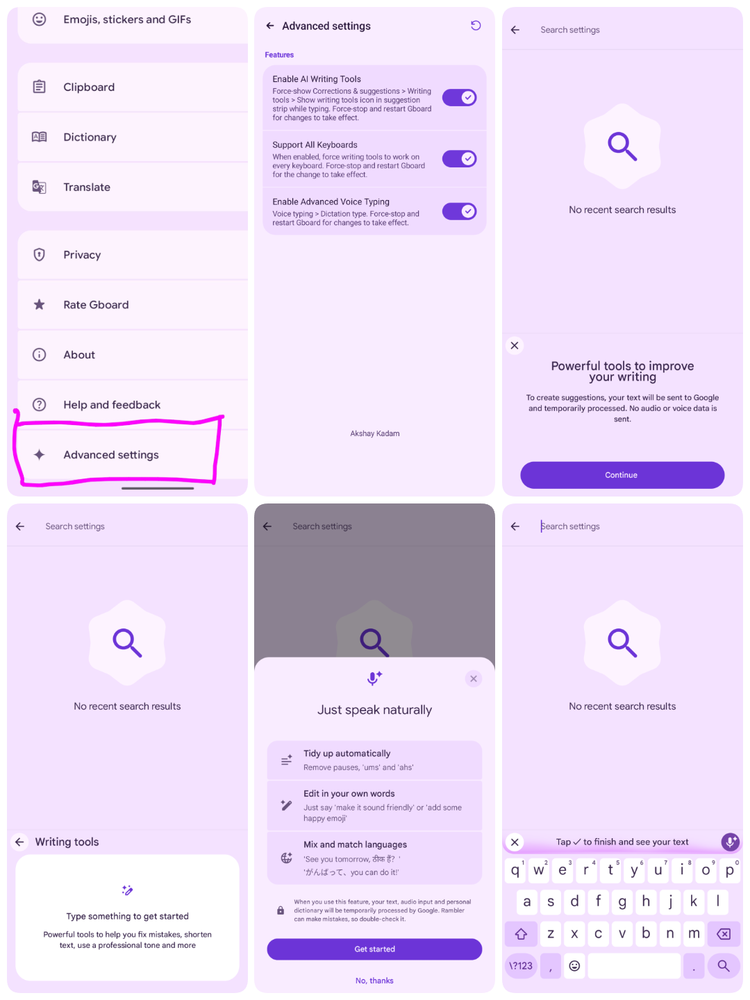

<div align="center">

# PixelBoard

**Supercharged Gboard Mod featuring Google Pixel 11 series's Rambler Voice Typing, AI Writing Assistant & Writing Tools V2 [No Root].**

<p>
  <a href="https://github.com/Akshayykadam/PixelBoard/releases/tag/1.3.4">
    
  </a>
  
  
  
  
  
</p>

<!-- Primary Action: Direct Download Links -->
<p>
  <a href="https://github.com/Akshayykadam/PixelBoard/releases/download/1.3.4/PixelBoard-1.3.4.apk">
    
  </a>
  &nbsp;&nbsp;
  <a href="https://github.com/Akshayykadam/PixelBoard/releases/download/1.3.4/patches-1.3.4.mpp">
    
  </a>
</p>

<p>
  <sub><b>Recommended:</b> Download the ready-to-install <b>APK</b> directly (pre-signed, no root needed, installs side-by-side with stock Gboard). Use the <b>Morphe Patch</b> only if patching manually on Gboard <b>v18.6.3.100</b>.</sub>
</p>

<p>
  <a href="https://github.com/Akshayykadam/PixelBoard/releases/download/1.3.4/PixelBoard-1.3.4.apk"> <b>⬇️ Direct Download APK (v1.3.4)</b></a> &nbsp;&bull;&nbsp;
  <a href="https://github.com/Akshayykadam/PixelBoard/releases/latest/download/PixelBoard.apk"> <b>⬇️ Latest APK (Direct)</b></a> &nbsp;&bull;&nbsp;
  <a href="https://github.com/Akshayykadam/PixelBoard/releases/download/1.3.4/patches-1.3.4.mpp"> <b>📦 Morphe Patch (v18.6.3.100 only)</b></a> &nbsp;&bull;&nbsp;
  <a href="https://github.com/Akshayykadam/PixelBoard/releases/tag/1.3.4"> <b>Release Notes</b></a> &nbsp;&bull;&nbsp;
  <a href="#installation-guide"> <b>Installation Guide</b></a> &nbsp;&bull;&nbsp;
  <a href="https://github.com/Akshayykadam/PixelBoard/releases"> <b>All Releases</b></a>
</p>

</div>

---

<a id="release-assets"></a>
## 📥 Release Assets (v1.3.4 / Gboard v18.6.3.100)

| Package | Type | Description |
| :--- | :--- | :--- |
| [**PixelBoard-1.3.4.apk**](https://github.com/Akshayykadam/PixelBoard/releases/download/1.3.4/PixelBoard-1.3.4.apk) | **Signed APK** *(Recommended)* | **Ready to install.** Pre-built, signed APK with all mods enabled. Installs side-by-side with stock Gboard without root (`com.akshaykadam.pixelboard`). Base Gboard v18.6.3.100 Release. |
| [**PixelBoard.apk** *(Latest Direct)*](https://github.com/Akshayykadam/PixelBoard/releases/latest/download/PixelBoard.apk) | **Signed APK** | Direct download link for the latest compiled PixelBoard release APK. |
| [**patches-1.3.4.mpp**](https://github.com/Akshayykadam/PixelBoard/releases/download/1.3.4/patches-1.3.4.mpp) | **Morphe Patch Bundle** | Standalone patch bundle for [Morphe Manager](#option-c-patch-via-morphe-manager-on-device-patcher). <br>**⚠️ Note:** This patch **only works on Gboard version 18.6.3.100** (`18.6.3.1002251336-release-arm64-v8a`). Older versions like 18.5 are **not** supported. |
| [**Stock Gboard v18.6.3.100**](https://www.apkmirror.com/apk/google-inc/gboard/gboard-the-google-keyboard-18-6-3-1002251336-release/) | **Base APK** | Official unmodified stock Gboard APK (`18.6.3.1002251336-release-arm64-v8a`) from APKMirror *(only required if patching manually with Morphe)*. |

### 🌟 What's New in v1.3.4
- **Base app is now updated to 18.6.3**
- **24-Hour Default Clipboard Retention**: Unpinned copied text and images are now kept for 24 hours (up from Google's 1-hour limit) by default.
- **100 Recent Clips History**: The recent unpinned clipboard items cap is raised from 5 to 100 clips, matching the clipboard's full capacity.
- **Customizable Retention Slider**: Pick between 1 hour, 24 hours, 7 days, 30 days, or Never in PixelBoard Clipboard Settings.
- **Clean Symbol Key Labels**: Fixed `?attr/` and `\?123` labels so question mark and symbol keys render cleanly.
- **Restored Advanced & Update Settings**: Ensured Settings and Updates sections are reliably accessible across all base APK configurations.

---

## Visual Tour & Screenshots

<div align="center">
  
</div>

---

## Overview

**PixelBoard** is a sleek, ultra-clean enhancement of Google's flagship keyboard. Tailored for pure productivity, PixelBoard strips away unnecessary bloatware and focuses strictly on powerhouse capabilities: **Gemini Rambler Natural Voice Dictation**, **AI Writing Assistant**, **Modern Spell Checker Suggestion Chips & Grammar Checking**, **Scan Text Camera OCR**, **Screenshot Floating Suggestions**, **Material 3 Expressive Rounded Keys**, **Google Sans Flex Keycap Typography**, **Proactive Undo in Suggestion Strip**, **Emoji Palette V2**, **Super Insert Quick Hub**, **Restored Emoji Size Slider & Vibrant Emojis**, **Samsung & Vivo Clipboard History Sync**, and **Automatic Zero-Restart Instant Activation**.

PixelBoard is engineered with an independent coexistence package ID (`com.akshaykadam.pixelboard`), allowing you to install and use it **side-by-side with your factory Gboard** without replacing, uninstalling, or risking system keyboard stability.

---

## Key Features

- 🎙️ **Gemini "Rambler" Natural Voice Typing**: Speaks naturally by filtering out stutters and filler words (*"um"*, *"ah"*), auto-corrects self-corrections on the fly, auto-punctuates sentences, and includes an ergonomically minimizable voice toolbar.
- 🤖 **In-Line AI Writing Assistant**: One-tap proofreading, grammar fixes via interactive suggestion chips, and quick tone rewrite (*Professional*, *Casual*, *Concise*, *Emotive*) across every application.
- 🔄 **In-App Updater**: Built-in update checker directly inside Settings to check for new releases, view changelogs, and download & install the latest PixelBoard APKs seamlessly.
- 📋 **Extended Clipboard Retention**: Customizable retention duration (1 hour, 24 hours, 7 days, 30 days, or Never) with recent unpinned history expanded to 100 clips, floating screenshot chips, and reliable clipboard sync on Samsung One UI & Vivo.
- ✍️ **Modern Spell Checker & Grammar Chips**: Interactive clickable suggestion chips, grammar checks, and native red squiggly underlines on misspelled words across all apps.
- 📷 **Scan Text (Camera OCR)**: Direct camera viewfinder tool in the toolbar to capture and extract text directly at your cursor from real-world documents.
- 🎨 **Material 3 Expressive Styling**: Pill-shaped rounded keycaps (Belka UI), Google Sans Flex variable typography, and restored vibrant emoji scaling with dedicated emoji tabs.
- ↩️ **Proactive Suggestion Strip Undo**: 1-tap Undo button right in the suggestion strip to instantly reverse unwanted autocorrections or accidental text deletions.
- 🛡️ **Side-by-Side Coexistence**: Installs as an independent package (`com.akshaykadam.pixelboard`) alongside your stock keyboard with bypassed signature verification.

> [!NOTE]
> **Google Pixel Device Support**: Advanced features (**Writing Tools V2** and **On-Device Private AICore / Astrea inference**) are available **only on Google Pixel devices**. Core **Rambler Natural Voice Typing**, **AI Writing Assistant**, proofreading, and tone rewrite work across all Android devices.

---

## How to Enable Rambler Voice Typing

Follow these quick steps to activate Google's Gemini-powered **Rambler** natural voice typing:

1. **Open PixelBoard Settings**:
   - Tap the **Gear (`⚙️`)** icon in the keyboard suggestion strip, or go to Android **Settings > System > Languages & input > On-screen keyboard > PixelBoard**.
2. **Select Rambler Dictation**:
   - Tap **Voice typing**.
   - Under **Dictation type**, choose **Rambler** (switch selection from *Standard* to *Rambler*).
3. **Instant Automatic Activation (No Restart Needed)**:
   - Your selection activates automatically in real-time — **no app restart or device reboot required**!
   - *(Optional)*: You can verify that **Enable Advanced Voice Typing** is toggled **ON** under **★ Advanced settings** (enabled by default). The toolbar **Restart (`↻`)** button remains available as an optional manual fallback if ever needed.
   > [!TIP]
   > Thanks to recent runtime enhancements, Rambler dictation initializes dynamically on the fly. You can immediately tap the microphone icon without needing to restart Gboard or kill the app process!
4. **Start Speaking Naturally**:
   - Tap any text box and hit the **Microphone** icon on PixelBoard.
   - You will see the **"Just speak naturally"** setup screen.
   - Tap **Get started** and speak freely — PixelBoard handles the cleanup automatically!

---

## Where to Find & Use AI Writing Tools

Google's **AI Writing Tools** allow you to proofread, rephrase, and adjust the tone of any text on the fly.

### 1. Where to Configure
- **In Advanced Settings**:
   - Open **★ Advanced settings** from the bottom of PixelBoard Settings.
   - Make sure **Enable AI Writing Tools** and **Support All Keyboards** are toggled **ON** (both ON by default).
- **In Corrections & Suggestions**:
   - In PixelBoard Settings, go to **Corrections & suggestions > Writing tools**.
   - Ensure **Show writing tools icon in suggestion strip while typing** is enabled.

### 2. Where to Access While Typing
- **Suggestion Strip (Quick Bar)**:
   - When typing in any text box across any app, the **Writing tools icon** (pen sparkle ✨) appears in the keyboard suggestion strip above your keys.
- **Keyboard Tools Menu**:
   - If the icon is hidden, tap the **4-squares / arrow icon** on the left of the suggestion strip to open the tools drawer and tap **Writing tools**.
- **Actions Available**:
   - **Proofread**: One-tap fix for grammar and spelling.
   - **Rewrite / Rephrase**: Adjust tone between *Professional*, *Casual*, *Concise*, and *Emotive*.

---

## ⚙️ Advanced Settings Screen

PixelBoard features a clean, minimal preference screen modeled directly after the native Material You Gboard UI:

- **Enable AI Writing Tools**: Force-shows the Writing tools icon in the suggestion strip across all apps and text views.
- **Support All Keyboards**: Extends AI writing assistance beyond English to all keyboard layouts.
- **Inference Backend Type**: On supported hardware, select between `GBOARD_SERVER`, `PRIVATE_INFERENCE_AICORE`, and `PRIVATE_INFERENCE_ASTREA`.
- **Enable Advanced Voice Typing**: Unlocks the *Rambler* dictation engine in Voice typing settings.
- **In-App Updates**: Built-in OTA updater to check for new releases, view changelogs, and download & install updates directly from GitHub.
- **Rounded Keys**: Enable Google's Material 3 Expressive Belka pill-shaped keycaps.
- **Multilingual Support**: Fully localized in 20+ languages matching your device's system locale.
- **Toolbar Restart Button (`↻`)**: Optional one-tap process reload utility in the toolbar if you ever want to force a refresh, though all settings and toggles apply automatically in real time without restarts.
- **Cleaned Preferences**: Promotional bloatware ("Rate Gboard" and "Help & feedback") has been completely removed.
- **Custom Attribution**: Dedicated credit footer (*Akshay Kadam*).

---

## Installation Guide

### Option A: Direct Download on Your Phone (Easiest)
1. Download [**PixelBoard Stable APK (v1.3.4, 122 MB)**](https://github.com/Akshayykadam/PixelBoard/releases/download/1.3.4/PixelBoard-1.3.4.apk) (or view the [**v1.3.4 Release Page**](https://github.com/Akshayykadam/PixelBoard/releases/tag/1.3.4)).
2. Tap the downloaded `.apk` in your notification drawer or Downloads folder.
3. If prompted, toggle **"Allow from this source"** and tap **Install**.
4. Enable PixelBoard in **Settings > System > Languages & input > On-screen keyboard**.

### Option B: Sideload via ADB (For Developers)
Connect your Android phone via USB with USB Debugging enabled:
```bash
adb install -r PixelBoard-1.3.4.apk
adb shell am force-stop com.akshaykadam.pixelboard
```
*(If building from source locally, use `adb install -r output/PixelBoard-1.3.4.apk`)*

### Option C: Patch via Morphe Manager (On-Device Patcher)
You can patch your stock Gboard APK directly on your phone using **Morphe Manager**:
1. Install **Morphe Manager** on your Android device.
2. Get the two required files:
   - **Patch Bundle**: [**PixelBoard.mpp**](https://github.com/Akshayykadam/PixelBoard/raw/main/patches/PixelBoard.mpp) (or versioned [**patches-1.3.4.mpp**](https://github.com/Akshayykadam/PixelBoard/releases/download/1.3.4/patches-1.3.4.mpp))
   - **Stock Base APK**: Download the official base bundle from [**APKMirror (Gboard v18.6.3.100 Release)**](https://www.apkmirror.com/apk/google-inc/gboard/gboard-the-google-keyboard-18-6-3-1002251336-release/).
3. In Morphe Manager, select **Storage**, choose the stock Gboard APK, and load `PixelBoard.mpp` as the patch source.
4. Tap **Patch** and then **Install**!

> [!IMPORTANT]
> **Strict Version Requirement**: The patch bundle **only works on Gboard version 18.6.3.100** (`18.6.3.1002251336-release-arm64-v8a`). It does **not** work on older versions (such as Gboard 18.5 or earlier) because internal flag evaluation classes (`Lodf.g`), text input dispatchers, and resource IDs changed between versions. Patching older versions will cause hooks to miss and mods to not engage. If you do not want to patch manually, install the pre-built [**Signed APK (Option A)**](#option-a-direct-download-on-your-phone-easiest) directly.

> [!TIP]
> You can also add PixelBoard as a custom auto-updating patch source in Morphe Manager by adding:
> ```text
> https://raw.githubusercontent.com/Akshayykadam/PixelBoard/main/patches-bundle.json
> ```

---

## 📁 Project Structure

```text
GBoardMod/
├── README.md                  # Project documentation & direct download links
├── build.sh                   # 1-click automated build & patching script (100% offline)
├── options.json               # Patch configuration profile
├── patches/
│   ├── PixelBoard.mpp         # Pre-bundled offline patch pack (~1.6 MB)
│   └── patches-bundle.json    # Morphe Manager repository metadata
├── input/
│   └── gboard.apk             # Base stock Gboard APK (v18.6.3.100 Release, ~122 MB)
├── output/
│   ├── PixelBoard.apk         # Compiled APK (local build output / hosted on GitHub Releases)
│   └── patching-result.json   # Patch verification report
├── tools/
│   ├── patcher.jar            # Standalone patch compiler CLI (Java 21)
│   └── patcher-data/          # Signing keystore & local storage
├── LICENSE                    # GNU General Public License v3.0
└── pixelboard-patches/        # PixelBoard patch source repository (Kotlin/Smali)
    ├── gradle/
    ├── patches/               # Patch definitions & Kotlin bytecode modifications
    └── extensions/            # Extension APK bytecode & runtime hooks
```

---


## Compatibility Matrix

| Property | Requirement |
| :--- | :--- |
| **Target Package** | `com.google.android.inputmethod.latin` |
| **Required Base Version** | `18.6.3.1002251336-release-arm64-v8a` (**v18.6.3.100** only) |
| **Unsupported Versions** | Gboard `18.5.x` and older versions are **not supported** by this patch bundle |
| **Architecture** | `arm64-v8a` |
| **Android Version** | Android 12 (API 31) through Android 16 / 17 Preview |
| **Root Required** | **No** (Standalone side-by-side coexistence) |

> [!CAUTION]
> **Gboard Version Dependency**: The patch bundle is engineered specifically for **Gboard v18.6.3.100**. Patching Gboard 18.5 or older will cause flag evaluation hooks (`Lodf.g`) and resource bindings to miss, leaving all mods inactive. Always ensure you are patching stock Gboard `18.6.3.1002251336-release-arm64-v8a` or directly download the pre-patched, ready-to-use [**PixelBoard-1.3.4.apk**](https://github.com/Akshayykadam/PixelBoard/releases/download/1.3.4/PixelBoard-1.3.4.apk).

> [!NOTE]
> **Google Pixel Device Support**: Advanced features (**Writing Tools V2** and **On-Device Private AICore / Astrea inference**) are available **only on Google Pixel devices**. Core **Rambler Natural Voice Typing**, **AI Writing Assistant**, proofreading, and tone rewrite work across all Android devices.

---

## Developer & Maintainer

**Akshay Kadam**
- GitHub: [@Akshayykadam](https://github.com/Akshayykadam)
- Project Repository: [PixelBoard](https://github.com/Akshayykadam/PixelBoard)

---

## Acknowledgements & Credits

Special thanks and sincere appreciation to:
- **AnhDuck** ([@AnhDuck](https://github.com/AnhDuck)) — For restoring the Rambler voice toolbar minimize key and contributing TalkBack accessibility labels for voice controls ([#108](https://github.com/Akshayykadam/PixelBoard/pull/108)).
- **Akash Mahedy** ([@akashmahedy](https://github.com/akashmahedy)) — For diagnosing the settings ID collision on Gboard 18.5+ and contributing the string resource resolution patch preserving the native Personal Dictionary and Physical Keyboard preferences ([#91](https://github.com/Akshayykadam/PixelBoard/issues/91), [#94](https://github.com/Akshayykadam/PixelBoard/pull/94)).
- **Animesh Ahilya** ([@animeshahilya](https://github.com/animeshahilya)) — For contributing a comprehensive TalkBack accessibility overhaul across settings: merged row semantics (`AccessibleRow`), TalkBack focus restoration across screen rebuilds, heading navigation, spoken warnings, and restart announcements ([#65](https://github.com/Akshayykadam/PixelBoard/pull/65), [#66](https://github.com/Akshayykadam/PixelBoard/pull/66), [#67](https://github.com/Akshayykadam/PixelBoard/pull/67)).
- **AbdulAziz Hatem** ([@AbdulAziz-Hatem](https://github.com/AbdulAziz-Hatem)) — For contributing complete Arabic (`ar`) localization for all Advanced Settings, AI Writing Tools, and Rambler dictation preferences ([#53](https://github.com/Akshayykadam/PixelBoard/pull/53)).
- **Mohamed Technology** ([@mohamedtechnology](https://github.com/mohamedtechnology)) — For reporting the TalkBack / screen reader dead zone in the features menu and providing the root cause analysis on window focus and `TYPE_WINDOW_STATE_CHANGED` ([#48](https://github.com/Akshayykadam/PixelBoard/issues/48)).
- **Andrew Matten** ([@andrewmatten](https://github.com/andrewmatten)) — For pinpointing the Gboard native dictation split readiness gate in `slc.a()` and contributing the verified bytecode patch for fused APKs on Pixel 8 Pro ([#50](https://github.com/Akshayykadam/PixelBoard/issues/50)).
- **Benestin** ([@Benestinlinson](https://github.com/Benestinlinson)) — For extensive multi-hour testing across releases, diagnosing spacebar auto-correction behavior ([#52](https://github.com/Akshayykadam/PixelBoard/issues/52)), and reporting screenshot chip synchronization and toolbar access point flow ([#44](https://github.com/Akshayykadam/PixelBoard/issues/44), [#47](https://github.com/Akshayykadam/PixelBoard/issues/47)).
- **Paolo Del Casale** ([@PaoloDelCasale](https://github.com/PaoloDelCasale)) — For deep BatteryStats investigations and candidate fixes resolving background `GoogleAsrService` persistence ([#3](https://github.com/Akshayykadam/PixelBoard/issues/3)) and the offline language pack download loop ([#5](https://github.com/Akshayykadam/PixelBoard/issues/5)).
- **Alin Cornel** ([@alincornel](https://github.com/alincornel)) — For identifying the root cause and implementing the fix for inline autofill suggestions from password managers (Bitwarden, 1Password, etc.) in the renamed package ([#24](https://github.com/Akshayykadam/PixelBoard/pull/24)).
- **JasonWu** — The pioneering author of the original Gboard patch project whose foundational reverse-engineering research and Smali patch framework made this mod possible.
- **The ReVanced & Morphe Open-Source Android Modding Communities** — For the open-source decompilation toolchains, patch compilers, and continuous ecosystem contributions.

---

## Legal Disclaimer

> [!CAUTION]
> **PLEASE READ THIS LEGAL DISCLAIMER CAREFULLY BEFORE DOWNLOADING, COMPILING, OR USING THIS SOFTWARE.**

1. **Non-Affiliation & Endorsement**: **PixelBoard** is an independent, non-commercial open-source modification project developed for interoperability and accessibility research. It is **not** affiliated with, sponsored by, authorized by, maintained by, or in any way associated with **Google LLC**, **Alphabet Inc.**, or any of their subsidiaries.
2. **Intellectual Property & Trademarks**: "Google", "Gboard", "Pixel", "Android", "Gemini", and all related logos, product names, and brand identifiers are trademarks or registered trademarks of Google LLC. All trademarks, service marks, and trade names referenced herein remain the property of their respective owners. Their mention in this repository is strictly for product identification and nominative fair-use purposes.
3. **Personal & Educational Use Only**: This software, including all patch definitions and compiled binaries, is provided solely for **personal education, private study, and experimental research**. It is not intended for commercial distribution or monetization.
4. **No Warranty ("AS IS")**: This software is distributed under an open-source license on an **"AS IS" BASIS, WITHOUT WARRANTIES OR CONDITIONS OF ANY KIND**, either express or implied, including, without limitation, any implied warranties of merchantability, fitness for a particular purpose, non-infringement, or system stability.
5. **Limitation of Liability**: Under no circumstances shall the author, contributors, maintainers, or distributors be held liable for any direct, indirect, incidental, special, exemplary, or consequential damages (including, but not limited to, data loss, device malfunction, service interruption, account penalties, or legal claims) resulting from the download, installation, execution, or misuse of this software.
6. **User Responsibility**: Users assume all risks associated with sideloading or executing third-party modified software on their devices and are individually responsible for complying with applicable local laws, regulations, and third-party terms of service.

---

<div align="center">
  <sub>Built with ❤️ for Google Pixel & Android Community</sub>
</div>
